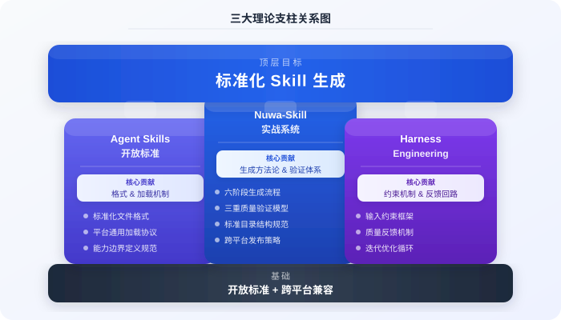
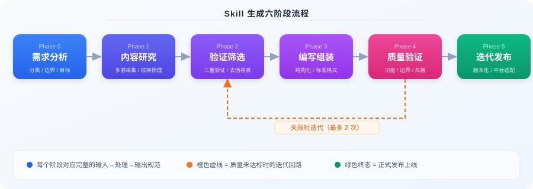
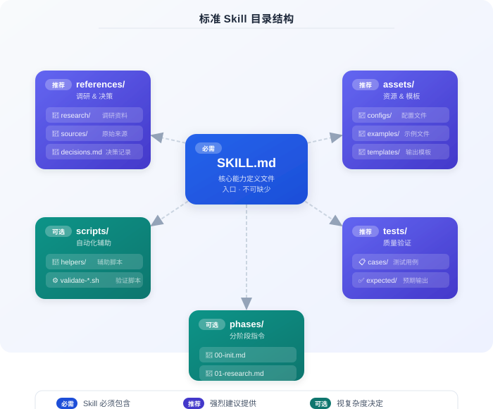

# 如何写出靠谱的 Agent Skill：一套标准化生成方案

AI Agent 的 Skill 越来越多，但大多数写得随意——没有统一结构，没有质量检查，没有明确的“什么算写得好”的标准。

结果是什么？

- **质量参差不齐**：写的人凭感觉，用的人靠运气。触发不准、约束不足、上下文炸裂是常态。
- **结构混乱**：每个人写的格式不一样，字段命名随意，別人拿到手看不懂、用不了。
- **无法复用**：每次都从零开始写，没有可继承的模板和规范。

这个项目要解决的就是这件事——**一套标准化的 Skill 生成工具**。定义清楚的目录结构、内容规范和质量检查流程，让写出来的 Skill 结构统一、可验证、可复用。

它本身也是一个 Skill。

---

## 一、基于什么标准



### 1. [Agent Skills 开放标准](https://agentskills.io/what-are-skills) — 格式与加载机制

定义了 Skill 的基本骨架：YAML frontmatter + Markdown 正文，以及最关键的**三阶段加载模型**：

- **发现（Discovery）**：Agent 启动时只读 metadata，知道有哪些 Skill 可用。
- **激活（Activation）**：触发条件命中后，加载完整 SKILL.md。
- **执行（Execution）**：按需加载 references、scripts、assets。

这套机制保证了上下文不被一次性灌满。

### 2. [Nuwa-Skill 实战系统](https://github.com/alchaincyf/nuwa-skill/blob/main/SKILL.md) — 生成方法论

贡献了**完整的方法论**：模板化、结构化、可验证。它的核心思想是 Skill 不是写出来的，是**研究出来的**——先做内容研究，再筛选验证，最后才组装。

它定义的「三重验证」（结构 + 逻辑 + 实际执行）提供了质量检查的参考框架。

### 3. [Harness Engineering](https://zhuanlan.zhihu.com/p/2014014859164026634) — 工程范式

提出了 Agent 工程的三个根本原则：

- **约束优于指令**：与其告诉 AI「怎么做」，不如限定「不能怎么做」。
- **反馈回路**：失败必须能回到上一阶段重做，而不是单向往下走。
- **环境设计**：好的输出来自好的环境（templates、references、constraints），而不是好的提示词。

### 综合后的核心设计理念

| 理念 | 来源 | 落地方式 |
|------|------|----------|
| 渐进式加载 | Agent Skills | 三阶段模型，按需加载 |
| 约束优于指令 | Harness | 用 constraints 字段限定边界 |
| 三重验证 | Nuwa-Skill | 结构校验 + 逻辑校验 + 执行验证 |
| 反馈回路 | Harness | Phase 4 失败必须回到 Phase 2 |

---

## 二、这个工具做什么

一句话：**输入需求，输出 Skill**。

这个工具本身就是一个 Skill（参见 [`SKILL.md`](./SKILL.md)），把它丢给任何支持 Skill 的 Agent，然后告诉它你想要什么：

```
帮我生成一个「代码审查」Skill，关注安全漏洞和性能问题，
输出结构化报告，支持多语言。
```

它会按 6 阶段生成流程逐步推进，产出一个标准化目录，包含：

- **三种模板**可选（workflow / cognitive / hybrid），覆盖多数常见场景。
- **三重验证**框架：结构由脚本自动检查，逻辑和执行需人工确认。
- **格式基于 Markdown + YAML frontmatter**，多数平台可直接加载或少量适配后使用。

不用你手写 frontmatter，不用你担心遗漏必需字段。

---

## 三、生成流程：6 个阶段，一条反馈回路

这是整个工具最值得讲的部分。



> **注意区分**：以下 6 个阶段是「本工具（Skill 生成器）的工作流程」，不是指最终生成的 Skill 的执行阶段。最终生成的 Skill 如果流程复杂，其执行阶段会拆分到 `phases/` 目录中。

### Phase 0：需求分析与分类

读取用户的自然语言需求，识别意图、目标平台、复杂度，最关键的是判断 Skill 类型——是流程类、认知类还是混合类。这一步决定了后续用哪个模板。

### Phase 1：内容研究

不同于直接生成，这一步会去搜集相关领域的最佳实践、参考案例、已有规范，沉淀到 `references/research/` 里。这是 Nuwa-Skill 强调的「先研究后写作」。

### Phase 2：验证筛选（三重验证·第一道）

研究内容不全部采纳，要过一遍**事实性、相关性、可操作性**的筛选。淘汰主观观点、过时信息、无法落地的建议。结果记录在 `references/decisions.md`。

### Phase 3：编写组装

基于模板填充内容。SKILL.md 写得**只够触发和路由**，详细内容拆到 phases/、references/、assets/ 里按需加载。这一步严格遵守渐进式加载原则。

### Phase 4：质量验证（三重验证·第二三道）

- **结构校验**：跑 `scripts/validate-skill.sh`，frontmatter、必需字段、目录结构挨个检查。
- **逻辑校验**：trigger 是否清晰、constraints 是否充分、output 是否可验证。
- **执行验证**：用 `tests/cases/` 跑实际样本，对比 `tests/expected/`。

> **关键反馈回路**：Phase 4 任何一项失败，**回到 Phase 2 重新筛选**，而不是在 Phase 3 打补丁。这是 Harness Engineering 的核心——失败要溯源，不要盖楼。

### Phase 5：迭代与输出

校验通过后输出最终 Skill 目录，附带使用说明、平台适配指引、变更记录。

---

## 四、标准目录结构



完整结构如下：

| 目录 | 级别 | 说明 |
|------|------|------|
| `SKILL.md` | 必需 | 核心指令文件 |
| `references/` | 推荐 | 研究资料、信息来源、设计决策 |
| `assets/` | 推荐 | 模板、配置、输入输出示例 |
| `tests/` | 推荐 | 验证用例和期望输出 |
| `phases/` | 可选 | 复杂流程的分阶段详细指令 |
| `scripts/` | 可选 | 辅助自动化脚本 |

**最小结构**只需要一个 `SKILL.md`。简单 Skill 这就够了。

**复杂 Skill** 建议至少包含：`SKILL.md` + `references/decisions.md` + `tests/`。

**完整结构**适合需要分发、复用、跨团队协作的生产级 Skill。

具体字段定义和规范见 [`standards/structure-spec.md`](./standards/structure-spec.md)。

---

## 五、Skill 分类与模板

三种模板对应三种不同的 Skill 运作方式：

| 模板 | 一句话理解 | 典型场景 | 选择依据 |
|------|-----------|---------|----------|
| **workflow** | 有固定步骤的流程自动化 | 代码审查、CI/CD 部署、报告生成、数据处理 | 你能画出明确的流程图 |
| **cognitive** | 提供思考方式和判断框架 | 架构决策顾问、风险评估、方法论应用 | 没有固定步骤，更多是「遇到 X 怎么想」 |
| **hybrid** | 有流程但每步需要判断 | 需求分析→方案设计、Bug 排查→修复建议 | 既有步骤顺序，又需要智能判断 |

**怎么选**：
- 如果你的任务可以写成 SOP 流程图 → `workflow`
- 如果你的任务更像「给我一个视角/框架来分析问题」 → `cognitive`
- 拿不准 → `hybrid`（大多数真实场景）

模板路径：
- [`templates/workflow-skill/`](./templates/workflow-skill/)
- [`templates/cognitive-skill/`](./templates/cognitive-skill/)
- [`templates/hybrid-skill/`](./templates/hybrid-skill/)

---

## 六、快速开始

**第 1 步：获取项目**

把本文件夹（`standardized-skill-generation`）整体拷到你的工作目录。

**第 2 步：把 SKILL.md 加载到你的 Agent**

直接丢进对话，或放到目标平台的 skills 目录。

**第 3 步：描述需求**

```
基于 standardized-skill-generation，
帮我生成一个「PR 审查」Skill，
关注 SQL 注入和异常处理，输出 Markdown 报告。
```

**第 4 步：等它跑完 6 阶段**

Agent 会按流程推进研究、筛选、编写、验证，过程中可能需要你补充信息或确认方向。中间任何阶段失败都会回滚重做。

**第 5 步：拿到产物，部署到目标平台**

```bash
bash scripts/validate-skill.sh path/to/generated-skill/SKILL.md
```

校验通过后，把目录拷贝到对应平台的 skills 路径即可。

---

## 七、项目结构

```
standardized-skill-generation/
├── README.md                          # 你正在看的这篇文章
├── SKILL.md                           # 核心：生成器本身（也是一个 Skill）
│
├── standards/                         # 规范文档
│   ├── structure-spec.md              # 目录结构与字段规范
│   ├── quality-checklist.md           # 质量检查清单
│   └── platform-compatibility.md      # 跨平台适配规则
│
├── templates/                         # 三种 Skill 模板
│   ├── workflow-skill/                # 流程类模板
│   ├── cognitive-skill/               # 认知类模板
│   └── hybrid-skill/                  # 混合类模板
│       （每个模板都包含完整目录骨架：
│        SKILL.md.template + assets/ + references/
│        + scripts/ + tests/）
│
├── examples/                          # 完整示例
│   └── example-code-review/           # 代码审查 Skill 实例
│       ├── SKILL.md
│       ├── assets/                    # 含 configs/examples/templates
│       ├── references/                # 含 research/sources/decisions
│       ├── scripts/helpers/
│       └── tests/                     # cases/ + expected/
│
├── docs/
│   └── directory-guide.md             # 目录说明详解
│
├── assets/images/                     # 文章配图
│   ├── three-pillars.svg
│   ├── skill-generation-flow.svg
│   ├── directory-structure.svg
│   └── platform-compatibility.svg
│
└── scripts/
    └── validate-skill.sh              # 通用格式校验脚本
```

每个目录都有自己的 README 或说明文件，照着模板填就行。

---

## 八、质量要求

生成的每个 Skill 必须过这条线：

- **结构完整**：metadata、trigger、constraints、output 字段不缺。
- **触发明确**：trigger 描述清晰，不会误激活，也不会漏激活。
- **约束充分**：constraints 限定了边界（不做什么、输出什么格式、最多多少字）。
- **可验证**：output 有明确的格式和质量标准，能被脚本或人工检查。
- **自包含**：依赖都在目录内，不靠外部状态。
- **测试可跑**：`tests/cases/` 至少有 1 个用例，有对应的 `expected/`。

详见 [`standards/quality-checklist.md`](./standards/quality-checklist.md)。

---

## 九、平台适配参考

因为核心格式是 Markdown + YAML frontmatter，多数平台可直接加载或少量适配后使用：

| 平台 | 部署路径 | 适配工作量 | 具体说明 |
|------|---------|-----------|----------|
| Qoder / Qoder Work | `.qoder/skills/` | 低 | 直接放入即可，支持 description 自动触发 |
| Claude Code | `.claude/skills/` | 低 | 目录格式一致，直接使用 |
| Cursor | `.cursor/rules/` | 中 | 需要把 SKILL.md 内容适配为 .mdc 规则格式 |
| Windsurf | `.windsurfrules` | 中 | 需合并为单文件，只保留核心指令 |
| Gemini CLI | 项目级配置 | 中 | 格式兼容但加载路径和触发方式不同 |
| GitHub Copilot | `.github/copilot-instructions.md` | 中 | 单文件模式，需合并精简 |
| 其他 MCP 工具 | 视具体实现 | 高 | 需自定义适配层 |

转换规则和具体操作见 [`standards/platform-compatibility.md`](./standards/platform-compatibility.md)。

---

## 十、参考资料

**三篇核心文章**

- [What are Agent Skills?](https://agentskills.io/what-are-skills) — 开放标准定义
- [Nuwa-Skill SKILL.md](https://github.com/alchaincyf/nuwa-skill/blob/main/SKILL.md) — 完整方法论
- [Harness Engineering](https://zhuanlan.zhihu.com/p/2014014859164026634) — 工程范式

**相关项目**

- [Anthropic Skills 文档](https://docs.anthropic.com) — Claude Code 的官方实现
- [Cursor Rules](https://docs.cursor.com/context/rules) — Cursor 的规则体系
- [MCP 协议](https://modelcontextprotocol.io) — 通用工具协议

**进一步阅读**

- [`docs/directory-guide.md`](./docs/directory-guide.md) — 目录使用指引
- [`examples/example-code-review/`](./examples/example-code-review/) — 端到端完整示例
- [`SKILL.md`](./SKILL.md) — 生成器本体的完整规范

---

> **核心观点**：标准化不是限制创造力，而是把创造力从重复劳动中解放出来。
> 写 Skill 应该像写函数：定义清晰、输入输出明确、可测试、可复用。
> 这套工具做的，就是把这个「应该」变成「默认」。
